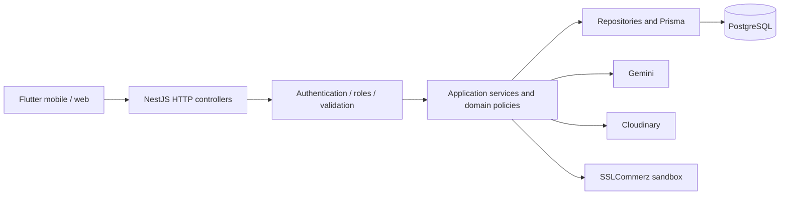

# Backend architecture

## Overview

NestJS 11 uses Express, dependency injection and feature modules; Zod validates incoming requests; Prisma 7 with the PostgreSQL adapter handles persistence; SQL migrations implement business constraints not expressible in Prisma alone. REST endpoints are URI-versioned under `/api/v1`.



## Source layout

```text
src/
  main.ts
  app/             root module, bootstrap, HTTP middleware
  core/
    auth/          JWT, access and role guards, refresh sessions, cookies, limits
    config/        typed and validated application configuration
    database/      Prisma service and module
    errors/        domain errors
    validator/     Zod validation pipe
  features/
    auth/          registration, login, profile and password hashing
    catalog/       categories, services, packages, offers and pricing
    scheduling/    persisted availability and workshop time
    appointments/  booking creation, ownership, cancellation
    assistant/     prompt, context, quota, model adapter, response validation
    admin/         catalog, offers, appointments and dashboard management
    media/         image validation and Cloudinary storage
    payments/      gateway initiation, verification and reconciliation
    platform/      public settings
    health/        process liveness
prisma/            schema, feature models, migrations and seeds
scripts/           admin CLI and schema/example export utilities
test/              unit and database-backed integration tests
```

## Separation of concerns

Controllers define HTTP contracts and validation, application services coordinate use cases, domain modules encode rules, and repositories implement storage. Simpler modules may combine application/persistence responsibilities. Shared guards enforce authentication by default; explicit public and optional-auth decorators define exceptions. Admin role checks are evaluated on authenticated requests using current database user state. No separate admin authentication system exists.

## Security and reliability

- JWT access tokens use HS256 and verify issuer, audience, expiry and session identity. Scrypt with random salt hashes passwords; timing-safe comparison protects verification.
- Refresh tokens are random, stored as SHA-256 digests and rotated transactionally. Reuse revokes the affected session. Browser refresh/logout use host-only HttpOnly cookies, exact trusted origins and session-bound CSRF tokens.
- Inputs use strict Zod schemas; the API rejects unauthorized ownership and forbidden admin actions. Helmet, body limits and sanitized parser errors protect request boundaries.
- Appointment creation derives price and identity server-side and relies on database exclusion/unique constraints for concurrency. Row locks serialize payment changes with cancellation and administration.
- Gemini receives only public catalog/settings, not personal records. Structured response validation and current-catalog checks restrict recommendation actions.
- Cloudinary and SSLCommerz credentials stay server-side. Gateway verification happens independently of client redirects. Private appointment/payment/assistant routes use no-store caching.

Rate limits for short windows are process-local; the assistant daily budget and payment reconciliation spacing are database-backed. For multi-replica production deployment, use shared ingress throttling. See [FEATURES.md](features.md) and [DATABASE.md](database.md) for business logic.

## Tests

Unit tests cover pricing, workshop time, authentication/config, admin and assistant logic. Integration tests cover auth, catalog, booking concurrency, ownership, admin, AI and payments. Test databases must be isolated because suites create/delete test rows and temporarily change seed records. No test execution is claimed by this documentation alone.
