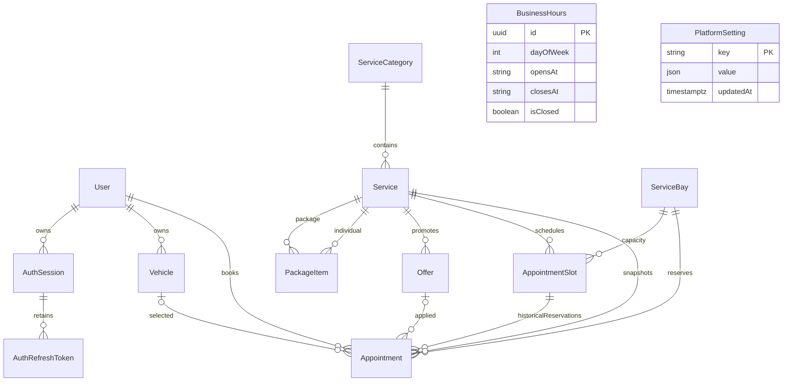

# Database

Prisma reads the `prisma/` schema directory; feature models live in `prisma/models/`. Entity IDs are UUID strings. `AuthRefreshToken.digest` is a 64-character lowercase SHA-256 hex primary key; `PlatformSetting.key` is a text primary key; `PackageItem` has composite `(packageId,serviceId)` identity. Use API IDs directly: Flutter demo slugs are not live IDs. `slug` is a separate unique catalog field. Timestamps are PostgreSQL `timestamptz`; money is `decimal(12,2)`; inclusions are `text[]`.

[DBML](schema.dbml) contains all migrated tables, columns, enums, foreign keys, unique/composite keys and constraint notes. Regenerate from a migrated database with `node scripts/export-schema.cjs`.

## Migrations

1. `202611170001_initial`: thirteen tables, four enums, relations, indexes and keys.
2. `202611170002_business_constraints`: SQL enabling `btree_gist`, normalized email, positive durations/quantities, price/discount checks, ordered intervals and valid hours. Package triggers prevent self/nested/non-individual contents and prevent changing composed service types.

`appointments_bay_no_overlap` combines `bay_id =` with `tstzrange(starts_at,ends_at,'[)') &&`, for `PENDING` and `CONFIRMED`. A partial unique index on `slot_id` has the same active-status predicate. Cancelled/completed appointments remain history but release capacity. Adjacent intervals are allowed. Slots for different services may overlap; appointments may not occupy the same bay concurrently.

Apply existing migrations with `npm run prisma:migrate:deploy`; develop changes with `npm run prisma:migrate:dev`. Do not replace migrations with `db push`: Prisma does not express the custom exclusion constraint, partial index or triggers. The migration role needs extension privileges, or an operator must preinstall `btree_gist`. No setup script resets a database.

Session deletion cascades to refresh history; user deletion cascades to sessions. Appointment references and vehicle/catalog relationships restrict deletion to preserve history. Disable catalog entries instead of deleting them. Consumed refresh history remains until an operator removes expired sessions; no scheduled cleanup is implemented.

## Seed and schedule

`npm run prisma:seed` is transactionally idempotent using slugs, deterministic sample-offer IDs, interval keys and bay names. Existing records are not overwritten. Offers start at first insertion and expire 90 days later; rerunning does not renew them.

| Item | Price BDT | Minutes |
|---|---:|---:|
| Exterior wash | 650 | 45 |
| Interior detailing | 2500 | 120 |
| Engine oil change | 3200 | 60 |
| AC inspection | 800 | 45 |
| Battery health check | 400 | 30 |
| Tyre & safety inspection | 600 | 30 |
| Express Car Care | 1400 | 105 |
| Premium Car Care | 3500 | 210 |
| Essential Maintenance | 3800 | 120 |

Flutter descriptions, inclusions and available Unsplash URLs are preserved in `prisma/seed-data.ts`. Packages each contain the three requested individual services, quantity one. Sample offers: 10% off Interior detailing (2250 effective), BDT 200 off Premium Car Care (3300 effective), while valid.

Two bays operate every day, 09:00–12:00 and 13:00–18:00 Asia/Dhaka, including Friday. `dayOfWeek` is 0=Sunday through 6=Saturday; local times use `HH:mm`. Separate intervals represent breaks. The afternoon accommodates the 210-minute premium package.

Availability generates requested dates on demand within a rolling window (default: today plus 29 days), at 15-minute increments. Slots persist with `(serviceId,bayId,startsAt)` uniqueness and stable IDs. Past slots remain; no `isBooked` flag or scheduled cleanup exists. Closed intervals, disabled bays, stale durations, times outside hours and past starts are excluded. The single-workshop implementation uses Asia/Dhaka's UTC+06:00 conversion.

The Gemini integration adds no tables. It uses reserved `PlatformSetting` keys `internal:assistant:requests:YYYY-MM-DD` with `{ "count": number }` for atomic shared daily usage limits. These keys are excluded from the public allowlist and provider prompts. They count requests only, never chat content, profiles or tokens. Do not edit active-day counters; old counters can be archived by an operator after their UTC day.

## Administration migration

`202611170003_admin` adds UserRole (CUSTOMER, ADMIN), a NOT NULL users.role column with CUSTOMER default, and media_assets (UUID, bytea data, verified mime_type, file_size, created_at). Existing users retain all data and become CUSTOMER automatically. The media check constraint enforces allowed MIME types, actual byte length and the 2097152-byte maximum. Uploaded binaries have no catalog joins and are selected only by public binary reads.

Deploy with `npm run prisma:validate`, `npm run prisma:generate`, `npm run prisma:migrate:deploy`; do not reset or replace earlier migrations. Database support/permissions for btree_gist remain required. Back up before deploying as usual. Create administrators explicitly with `npm run admin:create` after migration, never via ordinary catalog seed.

Service/package changes use serializable transactions; unique/FK conflicts become HTTP errors. Existing composition/type triggers remain intact. Future slot intervals follow duration edits transactionally, while appointment snapshots remain immutable. Booking takes a shared service lock to serialize against admin service edits. Appointment status updates condition on the previous status; completed/cancelled states leave the existing booking exclusion predicate and release capacity. All existing ownership constraints remain.

Schema documentation was exported from the isolated migrated test database; SQL migrations remain authoritative.
