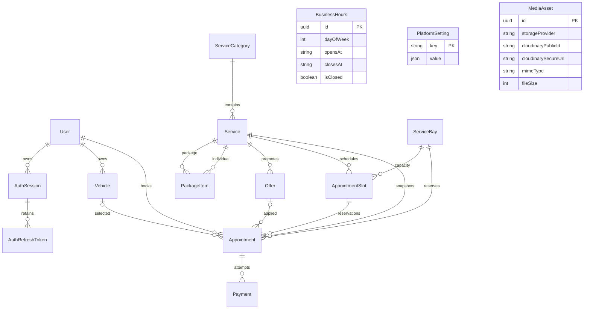

# Database design

PostgreSQL is authoritative. Prisma reads `prisma/schema.prisma` and feature models in `prisma/models/`; `prisma/migrations/` adds SQL constraints and is the canonical migration history. UUIDs identify entities except refresh token digests, setting keys and the composite package-item key. Money uses Decimal(12,2), timestamps use timestamptz, and workshop time is Asia/Dhaka.

MediaAsset, BusinessHours and PlatformSetting are independent tables; catalog images are URL references, not a MediaAsset foreign key.

| Entity | Purpose / important fields |
|---|---|
| User | unique normalized email, name, passwordHash, status, role |
| AuthSession | user reference, refresh digest, expiry, revocation and session metadata |
| AuthRefreshToken | digest primary key, session reference and consumed history |
| Vehicle | user-owned optional vehicle details |
| ServiceCategory | unique slug, active status, sort order, image URL |
| Service | category, individual/package type, price, currency, duration, inclusions, featured/active, image URL |
| PackageItem | composite packageId/serviceId key, quantity; individual component only |
| Offer | service, discount type/value, validity interval, active flag |
| ServiceBay | unique bay name and active flag |
| BusinessHours | unique weekday/open/close interval, closed flag |
| AppointmentSlot | service/bay, start/end, active flag; unique service/bay/start |
| Appointment | owner/service/slot/bay, optional vehicle/offer, status and price/name/duration snapshots |
| Payment | appointment, merchant reference, amount/currency, status, verification references, applied flag, incidents |
| MediaAsset | storage provider, optional legacy bytes, Cloudinary ID/URL, MIME, size |
| PlatformSetting | public settings and reserved internal assistant daily counters |

## Integrity and concurrency

The custom `btree_gist` exclusion constraint on appointments rejects overlapping `[start,end)` ranges within the same bay for pending/confirmed rows. The active-slot partial unique index also rejects two active bookings against a slot. Adjacent intervals are allowed. Cancelled/completed rows remain historical but release capacity. SQL check constraints validate normalized emails, money, duration, intervals, discounts, quantity and media metadata. Package triggers prohibit nested/self compositions and incompatible type changes. Appointment references use restrictive deletes to preserve history.

Payment migration adds unique merchant, validation and bank transaction references, partial unique indexes for one active and one applied payment per appointment, verification invariants and immutable financial snapshot protection. Payment/cancellation/admin operations lock the same appointment row. External gateway requests are outside database transactions.

## Migration history

1. `202611170001_initial` — initial entities, enums, relations and indexes.
2. `202611170002_business_constraints` — btree_gist, exclusion/partial unique indexes, checks and package triggers.
3. `202611170003_admin` — roles and legacy media storage.
4. `202611170004_integrations` — Cloudinary media metadata and payments.

Run `npm run prisma:migrate:deploy` on a prepared database, then optionally `npm run prisma:seed`. See [SETUP.md](setup.md). Do not use `db push` or reset as a substitute. Seed is idempotent and creates five categories, six individual services, three packages, two offers, two bays, fourteen business-hour intervals and ten public settings. Existing rows and offer expiry dates are preserved. Default hours are 09:00–12:00 and 13:00–18:00 daily. No users or bookings are seeded.

Optional full physical schema export: preserve the existing `docs/schema.dbml` or regenerate it from an isolated migrated database using `node scripts/export-schema.cjs`. Prisma models plus SQL migrations remain the source of truth. Historical slot/session cleanup and automated refund ledger are outside current scope.
